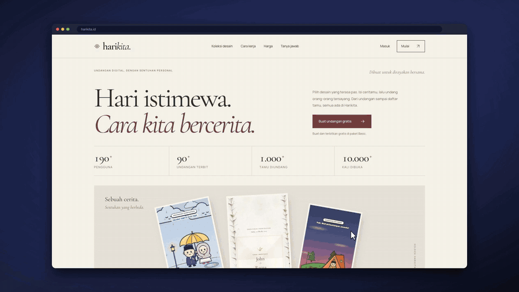
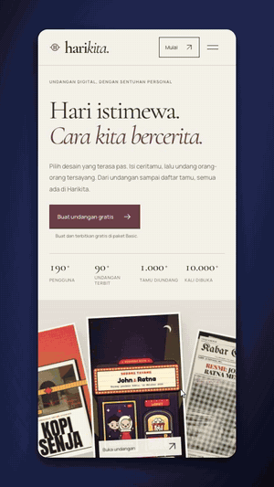
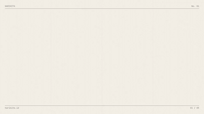

# demoin

**Give it a URL and a goal. Get a polished product demo video.**

```bash
npx demoin linear.app "create an issue and assign it to a teammate" --voice openai:alloy
```

<p align="center">
  
  <br>
  <sub>Recorded from one command against <a href="https://harikita.id">harikita.id</a>, untouched. GIF is sped up and silent; the <a href="docs/examples/harikita/harikita-desktop.mp4">mp4</a> has voiceover and click sounds. <a href="#example-harikitaid">How it was made ↓</a></sub>
</p>

An AI agent opens your site in a real Chrome, plans the video like a storyboard, clicks and types its
way to the goal, and renders an mp4 that looks edited by hand: smooth camera moves that follow the
action, an animated cursor with click ripples, spotlight and lightbox highlights, a browser frame on a
gradient backdrop, plus optional voiceover and subtitles.

Every run also writes a **replayable script**, so the next video of the same flow needs no AI at all,
which makes it cheap enough to regenerate your demos in CI on every release.

- **Any site, any language.** Works on production, staging and `localhost`. Narration in whatever language you ask for.
- **Any model.** Claude, Gemini, OpenAI, OpenRouter, or a local vision model through Ollama.
- **Voiceover that stays in sync.** The sentence is spoken *while recording* and the browser holds still for exactly
  that long, so voice and clicks line up without any audio stretching.
- **Subtitles** as `.srt`/`.vtt` sidecars or burned in.
- **16:9 or 9:16.** Desktop with browser chrome, or a phone frame for Reels, TikTok and Shorts.
- **MCP server.** Let Claude Code or Cursor record a demo of the feature it just built.
- **Credentials never reach the model.** The agent only sees `{{EMAIL}}` / `{{PASSWORD}}` placeholders.

## Example: harikita.id

[Harikita](https://harikita.id) is an Indonesian digital-invitation site. The UI is in Indonesian; the
narration below is in English, which demoin handles without any setup.

### 1. Record it with the agent (desktop, 16:9)

```bash
demoin harikita.id \
  "browse the invitation template collection, open one template to preview it, then show the pricing plans" \
  --model gemini:gemini-2.5-flash --voice say:Samantha --subtitles burn --sound --poster \
  -o docs/examples/harikita/harikita-desktop.mp4
```

```text
· Model: gemini:gemini-2.5-flash
· Voiceover: say:Samantha
· Opening https://harikita.id
· Plan: 1. Navigate to Design Collection, 2. Explore Invitation Designs, 3. Preview a Template, 4. View Pricing Plans
› 1. First, we will navigate to the design collection by clicking the "Koleksi desain" link.
› 2. The collection is organized into categories like "Pernikahan" for weddings, allowing users to filter designs easily.
› 3. We can browse through various invitation templates, and I will select "Bioskop Kita" to preview its design.
› 4. To close the preview and return to the main collection, click the "Tutup pratinjau" button.
› 5. To see the different pricing options, click the "Harga" link in the navigation bar.
· Agent finished: All sections of the video plan have been covered, and the pricing plans are now visible on screen.
· 1 steps did not change the screen, cut from the video.
· Rendering video…
· Voiceover: 4 clip(s) placed

✓ docs/examples/harikita/harikita-desktop.mp4
  41.0s, 4 steps (1 empty cut)
  The user navigates to the design collection, filters by category, previews an invitation template, closes the preview, and then views the pricing plans.
  script: docs/examples/harikita/harikita-desktop.demoin.yaml
  subtitles: docs/examples/harikita/harikita-desktop.srt
  poster: docs/examples/harikita/harikita-desktop.jpg
  gemini:gemini-2.5-flash: 8 calls, 33100 in / 3411 out tokens
```

Step 2 clicked the "Pernikahan" category tab, which changed nothing on screen; the pixel check caught
that and cut it, so the video has 4 steps. The whole run cost 8 model calls (about 36k tokens on Gemini Flash).

| Output | |
| --- | --- |
| Video (voiceover, click sounds, burned-in subtitles) | [`harikita-desktop.mp4`](docs/examples/harikita/harikita-desktop.mp4) |
| Replayable script | [`harikita-desktop.demoin.yaml`](docs/examples/harikita/harikita-desktop.demoin.yaml) |
| Subtitles | [`.srt`](docs/examples/harikita/harikita-desktop.srt) · [`.vtt`](docs/examples/harikita/harikita-desktop.vtt) |
| Poster | [`harikita-desktop.jpg`](docs/examples/harikita/harikita-desktop.jpg) |

### 2. Replay it for phones, no AI (9:16)

On phones Harikita tucks its navigation behind a menu button, so the desktop script was copied and
edited by hand: `device: mobile`, a "Menu navigasi" tap before each nav link, and shorter lines for a
vertical video. See [`harikita-mobile.demoin.yaml`](docs/examples/harikita/harikita-mobile.demoin.yaml).



```bash
demoin replay docs/examples/harikita/harikita-mobile.demoin.yaml \
  --voice say:Samantha --subtitles burn --sound --poster --strict \
  -o docs/examples/harikita/harikita-mobile.mp4
```

```text
· Voiceover: say:Samantha
· Opening https://harikita.id
› 1/6 click: Open the menu to find the design collection.
› 2/6 click: Tap "Koleksi desain" to see every invitation design.
› 3/6 click: Each design has a live preview. Let's open "Bioskop Kita".
› 4/6 click: Close the preview to go back to the collection.
› 5/6 click: Back to the menu for the pricing.
› 6/6 click: The free plan covers the basics; Premium unlocks every design.
· Rendering video…
· Voiceover: 6 clip(s) placed

✓ docs/examples/harikita/harikita-mobile.mp4
  53.9s, 6 steps
```

Zero model calls. `--strict` makes the replay fail if any element can no longer be found, which is
what you want in CI. Full video: [`harikita-mobile.mp4`](docs/examples/harikita/harikita-mobile.mp4).

<br clear="right">

## More styles: Quick and Studio (demoin.app)

This repository is the agent recorder. The hosted app, [demoin.app](https://demoin.app), adds two more
ways to make a video on top of it. **Their code is not part of this repository**; the samples below
were rendered by them from harikita.id so you can see what they produce.

**Quick** photographs a site's pages and animates them (logo intro, chapter titles, camera moves,
outro card with a call to action), with no agent and no clicking. Brand name, logo and colours are
read from the site itself.

| Quick, 16:9 | Quick, 9:16 |
| :---: | :---: |
| <a href="docs/samples/quick-harikita-desktop.mp4"></a> | <a href="docs/samples/quick-harikita-mobile.mp4"></a> |
| 5 pages, 50 s · [mp4](docs/samples/quick-harikita-desktop.mp4) | 5 pages, 55 s · [mp4](docs/samples/quick-harikita-mobile.mp4) |

**Studio** builds short motion-graphics promos from 18 templates (kinetic type, product cards,
tickets, counters, confetti, synthesized music with no copyright claims), editable scene by scene.
In these samples only the brand name and URL were set to Harikita; the rest is each template's
default copy.

| `editorial`, 16:9 | `kilat-diskon`, 16:9 | `hari-jadi`, 9:16 | `tiket-acara`, 9:16 |
| :---: | :---: | :---: | :---: |
| <a href="docs/samples/studio-editorial-desktop.mp4"></a> | <a href="docs/samples/studio-kilat-diskon-desktop.mp4"></a> | <a href="docs/samples/studio-hari-jadi-mobile.mp4"></a> | <a href="docs/samples/studio-tiket-acara-mobile.mp4"></a> |
| 26.5 s · [mp4](docs/samples/studio-editorial-desktop.mp4) | 15 s · [mp4](docs/samples/studio-kilat-diskon-desktop.mp4) | 17 s · [mp4](docs/samples/studio-hari-jadi-mobile.mp4) | 18.6 s · [mp4](docs/samples/studio-tiket-acara-mobile.mp4) |

The GIFs are sped up and silent; click through for the mp4 with sound.

## Install

Requirements: Node 20+, [ffmpeg](https://ffmpeg.org/download.html) on your `PATH`, and Google Chrome
(or any Chromium via `DEMOIN_EXECUTABLE_PATH`).

```bash
npm i -g demoin        # or run it with npx demoin
export ANTHROPIC_API_KEY=...   # or GEMINI_API_KEY / OPENAI_API_KEY
```

## Record with the agent

```bash
demoin <url> "<what the video should show>" [options]
```

```bash
# a tour of a landing page, vertical, with an offline macOS voice
demoin example.com "tour the homepage and the pricing section" --mode tour -d mobile --voice say:Samantha

# a signed-in flow on your dev server, shown as if it were production
demoin localhost:3000 "sign in, create a project, invite a teammate" \
  --cred EMAIL=demo@acme.com --cred PASSWORD=hunter2 \
  --display-host app.acme.com --voice elevenlabs:<voice-id> --subtitles burn

# narrate in Indonesian with Gemini
demoin tokopedia.com "cari sepatu lari dan buka detail produknya" --language Indonesian -m gemini:gemini-2.5-flash
```

Output lands in `./demoin-out/` (or `-o file.mp4`): the video, `.srt`/`.vtt` subtitles when there is
narration, and a `.demoin.yaml` script.

### Writing good goals

Describe what a viewer should **see**, in order: *"open Settings, switch to dark mode, then show the
billing page"*. The agent turns it into a short plan before recording, revises the plan once it is signed
in and can see the real menus, and stops when the plan is done. If it gets stuck (captcha, SSO-only
sign-in, a missing credential) it says so in the result instead of producing a misleading video.

## Replay a script, no AI

```bash
demoin replay demoin-out/acme.com-2026-10-24.demoin.yaml --voice openai:alloy
demoin replay flow.demoin.yaml --url https://staging.acme.com --strict   # CI: fail if the UI drifted
```

Scripts are plain YAML. Elements are matched by accessible name and placeholder first, then role
(the ARIA role, or the tag name when there is none), tag and type, with position only as a tie-breaker,
so they survive redesigns and are easy to edit by hand:

```yaml
demoin: 1
url: https://acme.com
device: desktop
credentials: [EMAIL, PASSWORD]
steps:
  - do: click
    target: { role: a, name: Sign in }
    narration: Start by signing in to your workspace.
  - do: fill
    target: { tag: input, type: email, placeholder: you@company.com }
    text: "{{EMAIL}}"
    narration: Enter your work email.
  - do: press
    key: Enter
    narration: ""
  - do: scroll
    deltaY: 600
    narration: Your projects are listed here.
```

Step kinds: `click`, `fill`, `press`, `scroll`, `wait`, `goto`. Optional `focus` per step:
`zoom | spotlight | lightbox | none`.

### Keep demos fresh in CI

See [`examples/github-action.yml`](examples/github-action.yml): it replays your scripts against
staging on every release and uploads the videos as artifacts, with no model key needed.

## Options

| Option | Meaning |
| --- | --- |
| `-m, --model provider:model` | `anthropic:claude-opus-5-5`, `gemini:gemini-2.5-flash`, `openai:gpt-5-mini`, `openrouter:<model>`, `ollama:<vision model>`, `openai-compatible:<model>` |
| `--mode howto\|tour` | complete a task, or introduce what is on screen (tour turns captions on) |
| `--steps n` | step budget (default 26) |
| `--language name` | narration language (default English) |
| `-d, --device desktop\|mobile` | 1920×1080 with browser frame, or 1080×1920 phone frame |
| `--style auto\|zoom\|spotlight\|lightbox\|none` | camera effect; `auto` lets the agent pick per step |
| `--voice provider[:voice]` | `openai:alloy`, `elevenlabs:<voice id>`, `gemini:Kore`, `say[:Voice]` (macOS, free) |
| `--subtitles none\|sidecar\|burn` | sidecar files, or also drawn into the video |
| `--captions` / `--no-captions` | step captions next to the element |
| `--sound` | click sounds |
| `--cred LABEL=value` | credential (repeatable); the model only sees `{{LABEL}}` |
| `--session cookies` | raw `Cookie` header or cookie JSON, for sign-ins the agent can't do (SSO, 2FA) |
| `--display-host host` | host shown in the fake browser bar |
| `--poster` | also write a poster `.jpg` |
| `--headful` | watch the browser while it records |
| `--json` | print the result as JSON |

## Models

The agent sends a labelled screenshot with every step, so the model must accept images.

| Provider | Env | Notes |
| --- | --- | --- |
| `anthropic` | `ANTHROPIC_API_KEY` | default `claude-opus-5-5`; `claude-haiku-5-5` is a cheaper option for simple flows |
| `gemini` | `GEMINI_API_KEY` | default `gemini-2.5-flash`, fast and cheap |
| `openai` | `OPENAI_API_KEY` | default `gpt-5-mini`; `OPENAI_BASE_URL` for proxies |
| `openrouter` | `OPENROUTER_API_KEY` | any vision model on OpenRouter |
| `ollama` | `OLLAMA_BASE_URL` | local, e.g. `ollama:qwen2.5vl:7b` |
| `openai-compatible` | `DEMOIN_LLM_BASE_URL`, `DEMOIN_LLM_API_KEY` | vLLM, LM Studio, Groq… |

Without `--model`, the first key found in the environment wins (`DEMOIN_MODEL` overrides that).
A typical 15-step run with Gemini Flash uses roughly 40k input tokens.

## Use it as a library

```ts
import { recordDemo, replayDemo } from "demoin";

const result = await recordDemo({
  url: "https://acme.com",
  goal: "show how to export a report",
  model: "anthropic:claude-opus-5-5",
  voice: "openai:alloy",
  subtitles: "burn",
  credentials: { EMAIL: "demo@acme.com", PASSWORD: process.env.DEMO_PASSWORD! },
  onLog: (e) => console.log(e.message),
});
console.log(result.video, result.script, result.summary);

await replayDemo({ script: result.script!, device: "mobile" });
```

You can also pass your own model object (`{ id, json(req) }`, see `src/llm/types.ts`) or TTS
(`{ id, synth(text, outBase) }`).

## MCP server

```bash
claude mcp add demoin -- npx -y demoin-mcp
```

Tools: `record_demo` (url, goal, mode, voice, device, credentials, …) and `replay_demo` (script, url, …).
Ask your coding agent things like *"record a 9:16 demo of the onboarding flow on localhost:3000 with a
voiceover"*.

## How it works

1. **Snapshot.** Each step, the page's interactive elements are collected (role, name, placeholder,
   required/disabled state, visible error messages, open dialogs) and drawn as numbered labels on a screenshot.
2. **Plan, then act.** The model writes a short storyboard first, then picks one action at a time with a
   narration sentence and a highlight effect. Guards catch the classic failure modes of web agents:
   clicks that change nothing, A-B-A-B loops, onboarding carousels, repeating the same server error,
   filling forms without submitting, signing up when it should sign in.
3. **Record.** Chrome's screencast is captured at 2× while a real mouse moves along the same eased path
   the video cursor will follow.
4. **Edit.** Dead time (page loads, model thinking) is compressed, steps that changed nothing are cut by
   comparing pixels, and the camera plan zooms to what each action *changed*, not just to the button.
5. **Render.** Frames are composited (backdrop, card, cursor, ripples, overlays) and piped to ffmpeg; the
   voiceover and subtitles are laid in on a second pass.

## Environment

| Variable | Purpose |
| --- | --- |
| `FFMPEG_PATH`, `FFPROBE_PATH` | ffmpeg binaries (default: from `PATH`) |
| `DEMOIN_EXECUTABLE_PATH` | Chrome/Chromium binary; otherwise the installed Google Chrome |
| `DEMOIN_BROWSER_CHANNEL` | Playwright channel (default `chrome`) |
| `DEMOIN_CHROME_NO_SANDBOX=1` | needed inside most containers |
| `DEMOIN_HEADFUL=1` | same as `--headful` |
| `OPENAI_TTS_MODEL`, `ELEVENLABS_MODEL`, `GEMINI_TTS_MODEL` | override TTS models |

## Development

```bash
pnpm install
pnpm test                        # browser regression cases against test/sites (no API key needed)
pnpm exec tsx test/render-smoke.ts
pnpm dev <url> "<goal>"          # run the CLI from source
```

## License

MIT
